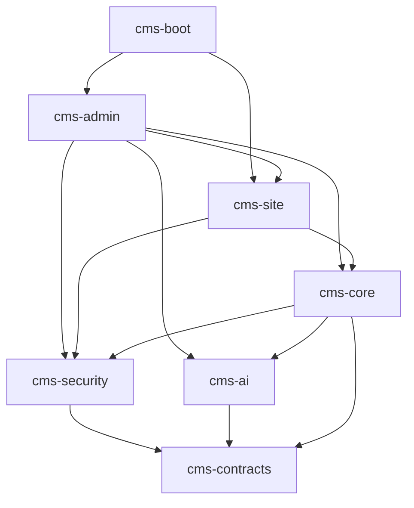

# Maven 模块与开发约定

根工程 `hongru-cms` 是聚合父 POM，保留原 groupId 与版本。以下模块依赖是编译期单向依赖，Maven reactor 会拒绝依赖环。

所有上层都可依赖 `cms-contracts`；`cms-boot` 显式装配全部模块。Java 包名尽量保持兼容，物理模块由职责与依赖决定，不按旧包名前缀机械切分。站点主数据已从 `ai.site.entity/mapper` 归入 `site.entity/mapper`。

## 模块边界

- `cms-contracts` 放实体、DTO、异常、配置属性、服务接口和端口，不依赖任何其他 CMS 模块。带框架注解的契约保留编译所需的轻量框架 API，不包含控制器或数据库实现。
- `cms-security` 通过 `AccountDirectory` 查询身份与角色；实现位于 core 的 `MyBatisAccountDirectory`，不反向依赖用户业务服务。
- `cms-ai` 负责模型与 Agent 适配，不持有 CMS 控制器、站点服务或内容持久化；AI HTTP 入口在 admin，站点 AI 业务编排在 core。
- `cms-core` 保留较完整的业务服务与持久化，不依赖 site/admin/boot。`TemplateFileAccess` 端口由 site 实现；启动 JAR 查找通过 `ApplicationArtifact` 交给 boot。
- `cms-site` 负责渲染、发布和站点扩展。`SiteServerRegistry` 提供状态查询，避免模板公共工具反向依赖站点管理器。
- `cms-admin` 负责 HTTP 管理入口、本地账号登录、拦截与请求适配。不得被业务模块引用。
- `cms-boot` 是唯一 `@SpringBootApplication` 和可执行 JAR；仅在这里进行 Spring Boot repackage、Playwright 裁剪、静态资源和部署装配。

MyBatis XML 只在 `cms-core/src/main/resources/mapper`；环境 YAML、Thymeleaf 和后端静态文件只在 `cms-boot/src/main/resources`。Vue 管理端只输出 `admin-ui/dist/` 并由 Web 服务器 standalone 部署，Maven 不将其收入后端 JAR。

## 统一实体和分页

持久化实体继承 `BaseEntity`，通过 `IntegerEntity`／`LongEntity` 共享有明确 Java 类型的自增主键，保留数据库原有 Integer/Long 类型。基类不强加不存在的审计或软删除列。使用 MyBatis-Plus 的 Mapper 继承 `CmsMapper<T>`；定制 XML Mapper 保留各自业务 SQL，不虚构通用 CRUD。`EntityFields` 统一遍历继承字段，导出、模板和 JSON 继续可见 `id`。

分页引擎只保留 MyBatis-Plus。新增列表使用显式 `IPage` 参数或 `Pages.query`，业务/API 返回 `PageResult`，保留 `list/total/pageNum/pageSize/pages` 语义。禁止使用 PageHelper 的线程分页状态。前台特殊 SQL 的 limit/count 查询可继续使用，但不再引入第二个分页插件。

## 统一 Session 与基础登录

管理员和会员共用 Spring Session Redis 存储及 Cookie 生命周期，分别使用 ADMIN、MEMBER 身份域。Redis 内仅保存稳定可序列化的 `SessionPrincipal(id, realm)`，当前账户状态与角色从数据库读取；不把整份 UserEntity、权限集合或会员资料长期写入会话。

登录轮换 Session ID，退出使整个会话失效，旧明文用户 ID Cookie 不能认证。会员接口改用 Session Cookie，移除 JWT 工具、拦截器及其依赖。写操作通过统一同源／可信来源校验。默认 Cookie 为 HttpOnly、SameSite=Lax；跨域部署需按实际 HTTPS/域名配置 Cookie 与可信来源。

基础版已移除集团 OAuth/CAS 回调和外部账号映射。通用会话身份通过 `/api/admin/v2/auth/session` 查询，不依赖 SSO。

Boot 4.1 通过 `spring-boot-starter-session-data-redis` 装配共享会话，配置前缀为 `spring.session.data.redis`。Spring Session 的自动装配、默认 Cookie 与 Redis 序列化依据：[Spring Boot Redis 集成](https://docs.spring.io/spring-session/reference/guides/boot-redis.html)、[Redis 配置](https://docs.spring.io/spring-session/reference/configuration/redis.html)。

## 内容模型与写入

`ContentFieldDefinition` 是字段目录、modelField JSON、编辑器、模板与校验共同使用的定义。`ContentModelCodec` 读写已有 JSON 数组，保留 `fieldName`、开关、输入方式、多选、顺序和校验属性；旧 `on/1/true` 开关均可读取。写入时检查字段名和重复字段，不要求清空或迁移已有业务数据。

字段目录表提供可选字段，栏目 modelField 保存所选字段配置，二者职责不同，但使用同一套 Java 定义。`FormFieldDefinition` 等只负责表单呈现，不是另一份内容存储模型。

内容实际唯一存储仍为 `t_contents`，审计在内容历史表。删除误导性的 `LegacyContentSyncService` 中间同步层，由 `ContentRecordService` 直接在事务中写内容和历史。更新必须命中当前站点、栏目和记录；不存在或越权记录不能被当成新增。只接收模型启用字段，拒绝修改标识、站点、栏目、状态等系统属性，保留既有审核发布流程。

现有 HTTP 内容 DTO 的 variant/version 占位字段暂保留以兼容管理端，不能据此引入第二套表或同步链。后续接口演进应与管理端一起删除占位字段。

## 循环依赖与运行约定

所有 profile 均关闭 `allow-circular-references`。已拆开的 Bean 环：用户服务与日志服务通过 `AdminUserQueryService` 解耦；栏目与内容服务之间的模型查询直接使用 Mapper；模板工具查询 `SiteServerRegistry` 而不依赖持有渲染器的站点管理器。不得重新用 `@Lazy` 或允许循环引用掩盖这些依赖。

运行工作目录统一为仓库根目录；`${user.dir}/runtime` 保持现有资源定位。自动测试默认不连接业务数据库；真实 dev 集成测试显式启用并使用独立会话命名空间，结束后清理自身数据。环境配置直接保留明确值，不再使用 `${CMS_...}` 占位参数。
