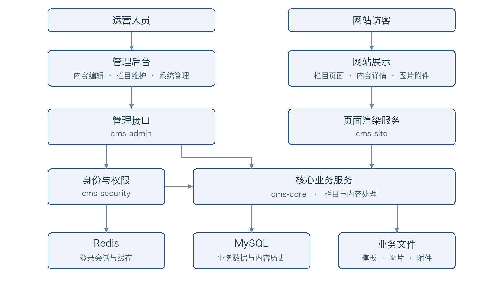

# Hongru CMS 技术架构方案

## 1 建设目标

Hongru CMS 为企业网站提供统一的内容管理与发布平台，覆盖栏目维护、内容编辑、页面展示、权限管理及日常运维。本方案以一个企业网站为应用场景，采用独立管理后台与网站展示服务协同运行的方式，支持运营人员持续更新网站内容，保持网站结构、视觉呈现与业务信息的一致性。

平台建设围绕以下目标展开：

- **便于运营**：集中维护栏目、文章、图片及页面资料，减少日常更新对开发人员的依赖。
- **统一展示**：通过页面模板规范内容呈现，保持网站风格和访问体验一致。
- **规范管理**：明确人员权限和内容操作范围，保留内容变更历史，支持问题追溯。
- **便于维护**：将管理、业务、页面和数据职责分开，降低后续功能调整的影响范围。
- **保障交付**：明确应用、数据库、文件资源及运行环境的交付边界，便于部署、备份与恢复。

## 2 总体架构

系统由管理后台、网站展示、核心业务、身份权限和数据资源五部分组成。运营人员通过管理后台维护信息，网站访客通过网站页面浏览内容，两类访问由不同入口承接，共同使用受控的业务服务和数据资源。

*图 1 系统总体架构*

**内容管理链路**：运营人员登录后台，在权限范围内维护栏目和内容，系统完成数据校验与保存，并按审核发布流程处理。

**网站访问链路**：访客打开网站页面，系统根据访问地址选择页面模板，读取相应内容并生成页面，同时加载图片、样式和脚本等资源。

管理后台与后端应用分别交付。后端内部按职责划分模块，由统一应用入口装配运行，兼顾集中部署的便利与模块化维护的清晰性。

## 3 技术体系

平台采用 Java 与 Spring Boot 构建后端，Vue 构建管理界面，MySQL 保存业务数据，Redis 支撑登录会话与缓存。各项技术围绕内容管理、页面展示和稳定运行形成完整协作链路。

| 技术领域 | 采用技术 | 对项目的作用 |
| --- | --- | --- |
| 后端应用 | JDK 21、Spring Boot 4.1 | 统一承载业务处理、接口服务与应用配置 |
| 管理界面 | Vue 3、TypeScript、Element Plus | 提供内容维护和系统管理操作界面 |
| 网站展示 | Thymeleaf、Undertow | 根据页面模板和业务数据生成网站页面 |
| 数据访问 | MyBatis-Plus | 组织数据查询、保存与分页处理 |
| 业务数据库 | MySQL | 保存栏目、内容、配置和操作历史 |
| 会话与缓存 | Redis、Spring Session | 管理登录状态并支撑缓存能力 |
| 工程构建 | Maven、Vite | 分别生成后端应用和管理端部署文件 |

## 4 模块分工

系统采用模块化组织方式，将共享规则、权限、内容业务、网站展示和管理入口分别维护。模块名称用于技术沟通和交付对接，中文说明对应各模块的实际职责。

| 模块名称 | 中文定位 | 主要职责 |
| --- | --- | --- |
| `cms-contracts` | 公共规范模块 | 统一数据定义和模块间接口，使各部分使用一致的信息格式 |
| `cms-security` | 身份权限模块 | 处理用户身份、登录会话、角色及操作权限校验 |
| `cms-core` | 核心业务模块 | 处理网站配置、栏目、内容及数据保存等业务 |
| `cms-site` | 网站展示模块 | 处理网站访问、页面路由、模板渲染与发布能力 |
| `cms-admin` | 管理接口模块 | 接收管理后台请求，衔接业务处理及统一登录回调 |
| `cms-boot` | 应用装配模块 | 统一加载配置和业务模块，形成可部署的后端应用 |

模块通过约定接口协作，核心业务与管理界面、页面展示保持职责分离。调整管理页面时可以减少对内容存储的影响，调整网站模板时也能继续复用已有业务数据。清晰的模块边界有助于故障定位、功能维护及后续交接。

## 5 内容管理与数据设计

### 5.1 栏目与内容组织

网站以栏目组织内容和访问入口，例如企业介绍、新闻资讯、产品展示和服务支持。各栏目根据业务需要配置内容字段及页面模板，使编辑方式与最终展示形式相匹配。

内容包含标题、图片、正文及栏目所需的业务字段。系统通过统一的字段规则连接编辑界面、数据校验和网站展示，减少不同环节对同一字段理解不一致的问题。

### 5.2 灵活的内容配置

栏目可以在系统支持的字段范围内选择启用字段、调整顺序并设置校验要求。例如，新闻栏目重点维护标题、发布时间和正文，产品栏目则可按实际字段配置维护图片及相关说明。

这类配置用于适配不同内容形式。超出现有字段和业务规则的新需求，应在需求评审后确定开发范围，保证编辑、存储和展示同步调整。

### 5.3 内容处理流程

1. **选择栏目**：运营人员进入目标栏目，新增或编辑内容。
2. **填写资料**：按照栏目配置填写文本、图片和其他业务信息。
3. **校验权限与数据**：系统检查操作权限、内容归属及字段要求。
4. **保存并记录历史**：内容与对应历史记录在同一数据库事务中保存，避免只保存其中一部分。
5. **审核与发布**：根据项目配置的审核发布流程处理内容，并检查最终页面展示。

内容更新需要匹配合法记录和所属栏目，系统不将无效更新自动转为新增。内容历史用于追溯修改过程；应用版本和站点文件的恢复由部署备份机制承担。

### 5.4 数据与文件分工

| 信息类型 | 保存位置 | 管理重点 |
| --- | --- | --- |
| 栏目、内容、业务配置与历史 | MySQL 数据库 | 数据准确性、访问权限与定期备份 |
| 登录会话及缓存 | Redis | 服务可用性、会话有效期与运行监控 |
| 页面模板与网站资源包 | 业务文件目录 | 版本一致性、发布管理与文件备份 |
| 上传图片及其他附件 | 配置的文件存储位置 | 路径稳定、容量管理与访问控制 |

数据库与文件资源共同构成网站运行基础。备份和恢复应覆盖两者，保证内容记录与对应图片、附件及页面模板保持一致。

## 6 页面展示与资源管理

### 6.1 页面生成方式

网站采用服务端模板渲染：系统根据访问地址确定栏目或详情页面，读取对应业务数据，再套用页面模板生成 HTML。页面模板控制版式与展示结构，内容数据负责填充具体信息。

这种方式使日常内容更新与页面设计相对分离。运营人员主要维护业务内容，页面布局调整由模板维护完成，从而保持网站整体风格一致。

列表分页、内容筛选等逻辑由业务服务统一处理，模板主要承担显示职责。页面需要对空内容、无图片、失效链接和无查询结果提供合理呈现。

### 6.2 资源维护

管理后台资源与网站展示资源分别管理。管理端构建文件独立部署，网站模板、样式、脚本和图片按业务目录组织。

页面更新时应同步检查模板、图片、样式和脚本版本，避免新旧资源混用。上传文件及运行过程中形成的业务资源纳入备份，确保恢复时网站页面与附件可正常访问。

## 7 身份与访问控制

平台通过身份、功能权限和内容归属三个层次控制操作范围：首先确认用户身份有效，再判断其是否具有目标功能的权限，最后检查其是否有权操作具体业务记录。

管理员和会员采用区分身份域的会话管理机制。登录状态由 Redis 集中保存，登录时更新会话标识，退出时使会话失效；账户状态和角色信息由系统重新读取，以反映当前授权情况。

接入统一身份认证时，平台通过 SSO 登录回调衔接外部身份服务，具体地址、账号规则及授权映射在项目实施阶段确认。

部署方案采用 HTTPS 保护传输，管理端优先通过同一访问域名转发接口请求，减少跨域配置复杂度。写入操作继续执行请求来源校验，防止不符合来源规则的请求直接修改数据。

预发布阶段可按配置启用页面访问保护，用于限制未正式发布页面的浏览。页面保护与后台权限分别管理，图片、附件及接口需要根据各自访问策略控制。

## 8 部署与运维方案

### 8.1 单站点部署结构

本方案以一套管理后台、一套 CMS 后端应用及一个网站展示入口组织部署，配套 MySQL、Redis 和业务文件存储。管理后台和网站可使用分别配置的访问域名，由反向代理服务统一转发请求。

| 部署组成 | 承载内容 | 运行要求 |
| --- | --- | --- |
| 管理端 Web 服务 | 后台页面及静态文件 | 配置页面访问、路由回退和管理接口转发 |
| CMS 后端应用 | 管理接口、业务处理及网站服务 | 使用 JDK 21，固定运行目录并加载对应环境配置 |
| MySQL | 栏目、内容和业务配置 | 设置访问权限、备份策略及恢复流程 |
| Redis | 登录会话及缓存 | 保障连接可用性，监控资源与运行状态 |
| 业务文件存储 | 模板、资源包、图片及附件 | 保持目录稳定，监控容量并定期备份 |

管理端与后端分别构建和部署。应用运行目录应与模板及业务文件目录保持约定关系，避免因路径变化导致资源不可用。服务器资源规格根据内容规模、访问量及页面复杂度确定。

### 8.2 发布与恢复

上线发布应统一管理前端文件、后端应用、环境配置、数据库变更和网站资源版本。数据库结构调整采用经过审核的增量脚本，并在执行前完成必要备份。

版本回退应明确恢复对象和顺序。应用文件回退不能代替数据库及业务文件恢复，涉及结构变化时需要评估旧版本兼容性。

日常运维关注网站可访问性、接口响应、数据库状态、Redis 连接、磁盘容量及应用日志。应用重启后，应检查网站入口和关键页面是否实际可用。

## 9 项目交付与质量要求

### 9.1 交付范围

项目交付包括管理端部署文件、后端应用包、网站模板与资源、必要的数据库脚本，以及部署配置和操作说明。环境地址、账号及敏感配置通过受控方式移交。

交付前应确认域名与证书、服务器资源、数据库及 Redis 环境、备份责任人、发布窗口和故障联系人，使技术交付与后续运维形成明确衔接。

### 9.2 验收要求

| 验收领域 | 主要检查内容 |
| --- | --- |
| 内容管理 | 栏目维护、字段校验、内容保存、历史记录及审核发布流程 |
| 页面展示 | 首页、栏目页、详情页、图片附件、分页及空数据展示 |
| 权限安全 | 登录退出、角色权限、内容操作范围及统一登录对接 |
| 运行部署 | 域名访问、接口转发、服务重启及文件路径正确性 |
| 备份恢复 | 数据与文件备份、版本对应关系及恢复操作可执行性 |
| 性能体验 | 代表性页面响应、并发访问表现及主要操作耗时 |

验收标准结合实际内容量、访问场景和项目约定确定。页面展示需通过真实业务数据与实际访问地址检查；性能指标通过约定环境中的测试确认。

### 9.3 持续维护

后续维护围绕内容运营、权限调整、模板优化、运行监控和备份管理开展。新增功能优先复用既有模块与接口，保持业务规则一致，并在上线前评估对页面、数据及运行环境的影响。
